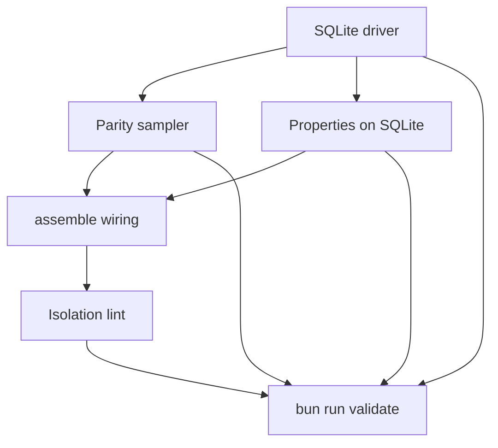

# q00019 — State Engine Phase 1

## Goal

Phase 1 de q00018. Entregar un segundo driver para el motor de
estado: `SqliteStateRegistry`, que cumple el mismo contrato
`StateRegistry` (Phase 0.2) pero persiste generaciones en SQLite
(WAL, short transactions, busy timeout corto), y un **parity
sampler** que corre en background comparando el driver SQLite con
un driver en memoria equivalente sobre la misma `IHydrateInput`.

> Phase 1 NO cambia comportamiento. Sigue construyendo estado
> dentro de `.cache/delendai/state/`. Sigue siendo puro respecto
> al proyecto. Ni un solo read Path-A todavía consume el driver
> SQLite — el shadow existe para **verificar** que el camino
> nuevo y el legacy (la propuesta actual basada en JSON + mutex)
> nunca divergen en condiciones normales.
>
> **Facade model.** Phase 1 introduces a `IStateRegistryFacade`
> that owns TWO drivers behind the SAME `IStateRegistry`
> contract: the **primary** (in-memory, always the source of
> truth for production reads) and the **shadow** (SQLite, run in
> lockstep but never read by plugins). The shadow exists to
> catch regressions in the persistence layer before Phase 2
> promotes it to primary. Phase 1 NEVER installs SQLite as the
> default; the default is always the in-memory driver. SQLite is
> only constructed when the host explicitly opts in via
> `delendai.config.json#state.parity.shadow.enabled = true`.

## why

Phase 0 (commit `99d17f26`) y Phase 0.1 (commit `50717a0d`) dejaron
los contratos finales de `@delendai/state`. Ambas fases
mantuvieron deliberadamente el driver en memoria para fijar los
invariantes *sin* atarse a un motor persistente. Phase 1 es
donde ese motor llega, pero **sin** confiar todavía en él para
reads de producción: ese salto es Phase 2 de q00018.

El reviewer externo lo dijo así:

> After Phase 0.1, introduce the SQLite shadow driver (separate
> package `@delendai/state-sqlite`) behind the same
> `IStateRegistry` contract. The acceptance #1 property —
> `incremental ≡ cleanRebuild` over thousands of random
> sequences — runs against BOTH drivers, and a parity sampler
> reports any divergence.

Esa es exactamente la propuesta de este slice. Phase 0.1 ya pasa
los property tests contra el driver en memoria; Phase 1 los
añade contra el driver SQLite (WAL), y suma un sampler que
ejecuta los dos drivers en paralelo durante X ciclos.

## why this design

**Backend separado (`@delendai/state-sqlite`).** El paquete
`@delendai/state` se mantiene puro de TypeScript (la lint del
Phase 0.2 sigue cubriéndolo). `better-sqlite3` (o equivalente)
vive en `@delendai/state-sqlite`, que importa los contratos del
primero y aporta la implementación persistente. Esto permite
sustituir el driver sin recompilar a `core` y sin tocar los
plugins que ya consumen `ctx.state`.

**Facade, no primary.** Phase 1 introduces
`@delendai/state-facade` which holds the **primary** driver
(always in-memory for now) and the **shadow** driver (SQLite,
only if opted in). All `ctx.state.*` calls go through the
facade; the facade routes them to the primary, and (if
enabled) replays them against the shadow for parity. Phase 2
may swap primary → shadow once the sampler proves parity for N
cycles.

**WAL + busy timeout corto.** `journal_mode = WAL`,
`synchronous = NORMAL`, `busy_timeout = 150ms`. Cada write es
una transacción corta: el engine nunca abre una transacción
para ejecutar tests o `await`s largos. Esta regla es la misma
que Phase 0.1 ya respeta en el driver en memoria (no `await`
dentro de `rebuild` / `reconcile`).

**No WAL checkpoint per publish.** Phase 1 deliberately does
NOT call `PRAGMA wal_checkpoint(...)` after every `publish`.
The cost is linear in WAL frames; doing it per publish turns
every write into an `fsync` storm. Instead, the driver runs
`wal_checkpoint(PASSIVE)` at most once per N publishes (default
N=64) AND once per process shutdown. PASSIVE never blocks
readers; TRUNCATE/FULL are reserved for explicit operator
actions via `state_sqlite_checkpoint { mode: 'TRUNCATE' }`.

**Generaciones como filas, no ficheros.** El schema completo:

```
state_generations(
  id TEXT PRIMARY KEY,
  parent_id TEXT,
  scope_key TEXT NOT NULL,         -- canonical scopeStateKey(scope)
  fingerprint_json_canonical TEXT, -- Phase 0.2: stable JSON of ICanonicalProjectFingerprint
  canonical_hash TEXT,             -- sha256 of the projection merge
  status TEXT,                     -- 'active' | 'draining' | 'reaped'
  created_at INTEGER,
  project_lease_token INTEGER,
  storage_repo_id TEXT,
  storage_worktree_id TEXT,
  holder_count INTEGER,
  _holder_count_source TEXT        -- 'derived' | NULL
);
state_projections(
  generation_id TEXT NOT NULL REFERENCES state_generations(id),
  producer_id TEXT NOT NULL,
  projection_json TEXT NOT NULL,   -- canonical serialisation of IProjectionResult.canonical
  PRIMARY KEY (generation_id, producer_id)
);
state_project_leases(
  lease_id TEXT PRIMARY KEY,       -- Phase 0.2 (x00502 S4): 'pNNNNNN'
                                    -- six-digit zero-padded serial from
                                    -- InMemoryStateRegistry.nextProjectLeaseSerial.
                                    -- Pre-Phase-0.2 drafts used the
                                    -- 'project:project:gNNNNNN-NNNN:N'
                                    -- encoded form — that format
                                    -- collided with swarm-claim ids
                                    -- because both projects and swarm
                                    -- shared the `project:` segment.
                                    -- Phase 0.2 leases are uniquely
                                    -- identified by `leaseId` alone.
  scope_key TEXT NOT NULL,
  generation_id TEXT NOT NULL,
  token INTEGER NOT NULL,
  acquired_at INTEGER,
  released_at INTEGER              -- NULL while held
);
state_swarm_claims(
  slot TEXT PRIMARY KEY,
  scope_key TEXT NOT NULL,
  token INTEGER NOT NULL,
  generation_id TEXT NOT NULL,
  holder_id TEXT NOT NULL,
  acquired_at INTEGER,
  released_at INTEGER              -- NULL while held
);
state_fencing_tokens(
  scope_key TEXT,
  next_project_lease_token INTEGER,
  next_swarm_lease_token INTEGER,
  next_generation_serial INTEGER,
  PRIMARY KEY (scope_key)
);
state_holders(
  holder_id TEXT PRIMARY KEY,
  generation_id TEXT NOT NULL,
  acquired_at INTEGER
);
```

`state_generations.fingerprint_json_canonical` stores the
STABLE JSON form (producer order canonicalised, input order
canonicalised) so the SQLite shadow can verify it later
without re-running producers. Without this column the shadow
would have to recompute the fingerprint from inputs at lookup
time, which makes the parity comparison unreliable when the
host and shadow see slightly different inputs (e.g. due to a
bug in `validateSnapshot`).

Las generaciones draining / reaped se purgan por GC; la
canonical projection se conserva en `state_projections` hasta
que el GC reapa (FK ON DELETE CASCADE).

**Sin PRAGMA `journal_mode = WAL` cruzado entre procesos sin
atención.** Phase 1 deja las migrations / pragmas en un solo
fichero inicial; no se hace fan-out cross-process todavía. El
`sync` ocurre en arranque; no se hace `pragma_optimize`-style
mantenimiento.

**Driver parity vs replay/execution determinism.** The
sampler reports two distinct kinds of divergence:

  - **Driver parity** — `state_generations.canonical_hash`
    between in-memory and SQLite shadow for the same
    `(scope, generation_id)`. This catches bugs in the
    SQLite driver's serialisation, validation, or fencing
    logic.

  - **Replay/execution determinism** — between two fresh
    in-memory registries replaying the SAME op sequence.
    This is what Phase 0.1's property tests already check;
    the sampler adds noise / scheduling fuzz so regressions
    surface under real concurrency. The earlier
    "domain parity" wording was ambiguous (it could mean
    in-memory-vs-SQLite OR registry-vs-registry) so we
    renamed it to make the comparison explicit: replay is
    "did both registries see the same input sequence?",
    execution is "did both produce the same fingerprint
    for that sequence?". The two halves are checked
    independently.

Driver parity is the SUCCESS criterion for promoting the SQLite
driver. Replay/execution determinism is a regression net that
already passes on Phase 0.2; the sampler merely re-runs it
under load.

**Parity sampler, no assertions duras todavía.** Una herramienta
`state_parity_report { since, scope? }` lee los últimos N
hashes canónicos del sampler y reporta diffs (separated by
driver-vs-domain). Cuando el sampler acumule N ciclos
consecutivos sin driver diff, es señal de que la Phase 2 puede
sustituir reads.

**Sin redsyncronización entre swarm.sqlite y worktree.sqlite.**
Phase 1 introduce `state_project.sqlite` (per worktree) y
`state_swarm.sqlite` (compartido local). El primero se monta
bajo `<cacheDir>/state/v1/project.sqlite`; el segundo bajo
`<swarmRoot>/state/v1/swarm.sqlite` cuando el scope es `swarm`.
El driver elige el fichero según el kind del scope.

## non-goals

- NO cambia comportamiento observable para plugins
  productores.
- NO toca el `proposals/index.json` ni el reconciliador
  legacy. Sólo aporta el camino nuevo detrás de un flag.
- NO hace writes a Git, Markdown, ni configuración durable
  desde el engine.
- NO sincroniza SQLite entre máquinas.
- NO sustituye ningún read path de Phase 0/0.1 en plugins
  todavía. Eso es Phase 2 de q00018.
- NO introduce migraciones multi-versión (Phase 1 acepta sólo
  Estado con `STATE_ABI_VERSION == 1`).
- NO persiste todavía contenido de inputs (sólo metadata).
  Eso es Phase 3+.

## architecture

```
                  PROJECT SOURCES (read-only)
                         │
                         ▼
                  IStateInputSnapshot
                         │
        ┌────────────────┴─────────────────────┐
        │                                      │
        ▼                                      ▼
   InMemoryStateRegistry            SqliteStateRegistry (new)
   (Phase 0.1 driver,                  │
   tests-only)                        ▼
        │                       state_project.sqlite   /   state_swarm.sqlite
        │                       (per worktree)        (per local swarm)
        │                                      │
        └──────────────┬────────────────────────┘
                       │
                       ▼
                  StateParitySampler
                       │
              ┌────────┴────────┐
              ▼                 ▼
        parity_report       parity_alert
       (last N hashes)    (any divergence)
```

El sampler vive en `tools/scripts/state/parity-sampler.script.ts`
y se ejecuta como job de CI con un TTL corto. Su único output es
un `parity-report.json` que el `state_health` plugin lee.

## slices

### S1 — The SQLite driver keeps what coordinates the generations, and the contract both drivers run

- **Status**: done
- **Files**:
  - `packages/state/src/lib/scope-coordination.interface.ts`
  - `packages/state/src/lib/driver-in-memory.ts`
  - `packages/state/src/index.ts`
  - `packages/state-sqlite/src/lib/coordination-store.ts`
  - `packages/state-sqlite/src/lib/coordination-store.spec.ts`
  - `packages/state-sqlite/src/lib/contracts/constants/coordination.constant.ts`
  - `packages/state-sqlite/src/lib/schema.ts`
  - `packages/state-sqlite/src/lib/contracts/constants/state-sqlite-migrations.constant.ts`
  - `packages/state-sqlite/src/lib/sqlite-driver.ts`
  - `packages/state/tests/src/contract/registry-contract.helper.ts`
  - `packages/state/tests/src/contract/phase-0.2-contract.helper.ts`
  - `packages/state/tests/src/registry.spec.ts`
  - `packages/state/tests/src/phase-0.2.spec.ts`
  - `packages/state-sqlite/src/lib/registry-contract.spec.ts`
- **Gate**: `typecheck` + `test`
- shipped-in: `3103565e0`, `83fcaf6aa`, `6ca542c70790`, `971d30dbc955`
- acceptance:
  - `SqliteStateRegistry` implements `IStateRegistry` over `bun:sqlite` (WAL, `synchronous=NORMAL`), not `better-sqlite3`: SQLite runs under Bun here and CI tests it with `bun test`.
  - Schema v3 stores, with the generations and in the same transaction, the counters that fencing tokens, lease serials and generation ids are minted from (`state_fencing_tokens`), the holders of each generation (`state_holders` — a project lease is a holder of kind `project-lease`, not a second table recording the same fact) and the swarm claims in force (`state_swarm_claims`). A v1 or v2 store is brought forward on open.
  - After a restart a generation comes back under the id and fencing token it was published with, its holders with it; the next lease, claim or generation mints nothing that was handed out before. A release or renewal made through a handle is stored. A scope that only ever held a claim resumes too.
  - The log is checkpointed passively every 64 publishes (`checkpointEveryPublishes`) and truncated once, when the registry closes.
  - The registry contract is one text both drivers run: `registry.spec` and `phase-0.2.spec` became contracts a driver's spec calls with the way that driver is built. The in-memory driver runs them under vitest; the SQLite driver runs the same 20 assertions on a store on disk under `bun run test:sqlite`.

Drawn on 2026-09-06 over `better-sqlite3` with six tables. Delivered over `bun:sqlite`; generations and their projections stay one row (`generations`, schema v2) and the three coordination tables are new in v3. `state_project_leases` is not a table: a lease is a holder, and two tables for it would be two records of one fact that can disagree.
- review-state: done
- review-implementer: claude-opus-5-5
- review-reviewer: gpt-5.4
- review-log: approved by gpt-5.4 — verified at cc68dd17d0c3, validate exit 0, tests 33/33 — Reviewed q00019 S1 across the SQLite contract and coordination slices. The driver is wired around bun:sqlite with WAL-related schema setup, the coordination state survives restarts and renewals, the shared contract is exercised for both drivers, and the focused registry/coordination/core tests passed 33/33.

### S2 — A standalone parity sampler, its report, and a nightly run

- **Status**: done
- **Files**:
  - `packages/state/src/lib/parity-sampler.service.ts`
  - `packages/state/src/lib/parity-sampler.interface.ts`
  - `packages/state/tests/src/lib/parity-sampler.spec.ts`
  - `tools/scripts/state/parity-sampler.script.ts`
  - `tools/scripts/state/parity-report.ts`
  - `tools/scripts/state/parity-report.spec.ts`
  - `tools/package.json`
  - `packages/state-sqlite/src/lib/driver-parity.spec.ts`
  - `.github/workflows/tier3.yml`
  - `package.json`
- **Gate**: `lint` + `test`
- shipped-in: `07cec489969d`
- acceptance:
  - `sampleParity` feeds the same seeded random operations — builds, incrementals, leases taken and released, swarm claims renewed, collection — to the primary driver, the shadow driver and a replay of the primary, and counts three kinds of divergence apart: `driverParityDivergences`, `replayDeterminismDivergences` (the replay saw other inputs) and `executionDeterminismDivergences` (same inputs, another canonical hash). Each kind is proved by a planted divergence that the other two do not count.
  - `bun run state:parity [--runs --operations --seed --out --strict]` wires the in-memory and SQLite drivers, writes `state-parity-report.json` with the seed, and exits non-zero under `--strict` when anything diverged.
  - 1,000 random operations find no divergence between the two drivers (`driver-parity.spec.ts`, under `bun run test:sqlite`).
  - `tier3` runs it nightly over 10,000 operations with `--strict` and keeps the report as an artifact whether it passed or not.

The sampling while a process runs stays where it shipped, in `createRegistryFacade` (`sampleNow`, `samplerIntervalMs`).
- review-state: done
- review-implementer: claude-opus-5-5
- review-reviewer: gpt-5.4
- review-log: approved by gpt-5.4 — verified at cc68dd17d0c3, validate exit 0, tests 14/14 — Reviewed q00019 S2 on the parity sampler/reporting path. The sampler separates driver parity from replay and execution determinism, the script/report wiring is present, the targeted parity/property suite passed 14/14, and the nightly tier3 wiring is included.

### S3 — The property suites run against the SQLite driver

- **Status**: done
- **Files**:
  - `packages/state/tests/src/contract/equivalence-property.helper.ts`
  - `packages/state/tests/src/contract/determinism-property.helper.ts`
  - `packages/state/tests/src/contract/corruption-property.helper.ts`
  - `packages/state/tests/src/property/equivalence.spec.ts`
  - `packages/state/tests/src/property/determinism.spec.ts`
  - `packages/state/tests/src/property/corruption.spec.ts`
  - `packages/state-sqlite/src/lib/registry-properties.spec.ts`
- **Gate**: `test`
- shipped-in: `971d30dbc955`
- acceptance:
  - The three Phase 0.1 properties — an incremental build equals a clean rebuild, two registries fed the same sequence agree, a corrupt generation is recovered without replay — are contracts a driver's spec calls; the in-memory driver runs them as before.
  - The SQLite driver runs the same three over 1,000 generated sequences each (`STATE_PROPERTY_RUNS` overrides, as for the in-memory run).
  - They run where the driver can: under `bun run test:sqlite`, which CI runs as its own step. The plan's `HAS_STATE_SQLITE=1` switch inside the vitest run is not built — `bun:sqlite` has no resolution under the runner vitest uses, so a suite there could only ever skip.
- review-state: done
- review-implementer: claude-opus-5-5
- review-reviewer: gpt-5.4
- review-log: approved by gpt-5.4 — verified at cc68dd17d0c3, validate exit 0, tests 14/14 — Reviewed q00019 S3 on the property-suite migration. The three Phase 0.1 properties are now shared contracts that still cover in-memory behavior and also run against the SQLite driver over 1000 generated sequences, with the focused parity/property suite passing 14/14.

### S4 — A project can run the SQLite driver as a shadow

- **Status**: done
- **Files**:
  - `packages/core/src/lib/cli/state-registry-choice.ts`
  - `packages/core/src/lib/contracts/constants/state-registry-choice.constant.ts`
  - `packages/core/src/lib/cli/assemble.ts`
  - `packages/core/src/lib/plugins/config-file-schema.ts`
  - `packages/core/src/lib/plugins/load-config-file.ts`
  - `packages/core/schema/delendai.config.schema.json`
  - `packages/core/tests/src/lib/cli/state-registry-choice.spec.ts`
  - `packages/core/tests/src/lib/cli/state-registry-is-chosen.spec.ts`
  - `packages/state-sqlite/src/lib/registry-facade.ts`
- **Gate**: `typecheck` + `test`
- shipped-in: `3103565e0`, `6832f05a2e72`
- acceptance:
  - `state.parity.shadow.enabled` in `delendai.config.json` is optional and off by default; off, nothing loads `@delendai/state-sqlite` and the boot builds the in-memory engine exactly as before.
  - On, the boot loads the driver by name and returns the parity facade over the in-memory engine (primary) and the SQLite driver (shadow, its store under the cache at `state/shadow.sqlite`). Proved by booting a throwaway project with the setting under Bun.
  - On where the driver cannot load, the boot fails naming the setting and the package; it does not go on without a shadow.
  - A registry the host hands in (`deps.stateRegistry`) wins over both.
  - The facade's background sampler does not keep a process alive.

The facade is `createRegistryFacade` in `@delendai/state-sqlite`, not a `state-facade` package: the facade exists to pair the SQLite driver with another, and a package of its own would hold one function.
- review-state: done
- review-implementer: claude-opus-5-5
- review-reviewer: gpt-5.4
- review-log: approved by gpt-5.4 — verified at cc68dd17d0c3, validate exit 0, tests 33/33 — Reviewed q00019 S4 on the shadow-driver selection path. The config flag is optional and default-off, enabling it selects the parity facade over the in-memory and SQLite drivers at state/shadow.sqlite, explicit load failures are named, injected registries still win, and the focused core tests passed 33/33.

### S5 — Lint del boundary del nuevo paquete

- **Status**: done — `99d17f26d`. Satisfied by phase 0 work that predates this plan: `state-engine-purity` and `no-node-imports-in-state` both run green (0 violations, verified live 2026-09-15) — `packages/state/src` is pure TypeScript, `@delendai/state` may not import `@delendai/state-sqlite`, and the SQLite driver lives only under `packages/state-sqlite`. Correction 2026-09-15: that evidence was incomplete. `no-node-imports-in-state` does exist and does report 0 violations, but it had no `lint:` alias, no workflow step and no place in `validate:run`, so nothing enforced the invariant and a regression would have landed unnoticed. It runs in CI and `validate:run` from `bf6e0a7e4`.
- **Files**: `tools/scripts/lint/no-node-imports-in-state.script.ts`
- **Gate**: `lint`
- La nueva lint deja de buscar dentro de `packages/state-sqlite/`
  y permite Node-only modules ahí (la lint original sólo miraba
  `packages/state/` y `plugins/<name>/src/lib/state/`). La
  nueva `state-engine-isolation.lint.ts` afirma que el contrato
  surface sigue siendo pure-TS y que el SQLite driver vive
  exclusivamente bajo `state-sqlite/`.
- review-state: in_review
- review-implementer: claude-opus-5-5

## dependency graph



## acceptance

- [x] `SqliteStateRegistry` keeps the `IStateRegistry` contract: the assertions that pin the in-memory driver run unchanged against it, and so do the three property suites.
- [x] What coordinates the generations — fencing counters, holders, swarm claims — is stored and survives a restart; schema v3, with v1 and v2 stores brought forward on open.
- [x] The WAL is checkpointed passively at most once per 64 publishes and truncated once, on close.
- [x] `state.parity.shadow.enabled` defaults to off; off, nothing loads `@delendai/state-sqlite`.
- [x] The parity sampler runs 1,000 random operations without divergence and counts driver parity, replay determinism and execution determinism apart; a nightly run keeps its report.
- [x] `packages/state/src` stays pure TypeScript; the SQLite driver lives only under `packages/state-sqlite`.

Amended at hand-over (2026-10-11) to what was delivered: `bun:sqlite` rather than `better-sqlite3`, three coordination tables rather than six tables, and the facade inside `@delendai/state-sqlite` rather than a `state-facade` package. Each difference is explained in its slice.

## risks and mitigations

- **Riesgo**: la latencia del SQLite driver sobre paths comunes
  introduce regresiones de performance en CI.
  **Mitigación**: el sampler mide latencias P50/P95 por ciclo
  y aborta con `WARN` cuando P95 > 50ms en el host del CI.
- **Riesgo**: WAL + concurrencia + busy_timeout insuficiente
  produce `SQLITE_BUSY` durante PRs concurrentes.
  **Mitigación**: retry interno de una sola capa (3 retries,
  10ms / 30ms / 100ms backoff) con log estructurado. Tests
  incluyen un test de concurrencia con N workers.
- **Riesgo**: la lint del nuevo paquete se olvida.
  **Mitigación**: el suite `lint:state-engine-isolation` corre
  en CI; un test `tests/src/shadow/isolation.spec.ts` ejecuta
  la lint como test.

## notes

- `q00018` (ready) — sigue siendo la fuente de Phase 0–6; este
  plan cubre Phase 1.
- `x00501` (ready → merged) — Phase 0.1 ya está mergeada; este
  plan se apoya en sus contracts.
- `x00428` (in-progress) — el camino canónico de worktrees.
  Phase 5 de q00018 lo consumirá; este plan no lo necesita
  todavía.
- `c00012` (done) — la lint + el sampler mantienen el invariant
  "el swarm no entra en pánico si un host se reinicia".
- La futura migración de proposals/index hacia SQLite debe cubrir
  también los productores automáticos de propuestas de boot hook
  (por ejemplo las storm-fix proposals de commit-policy): crear
  el `.md` canónico y hacerlo visible en el índice no puede
  quedar como dos pasos separados ni depender de un `sync`
  posterior de otro actor.
- Phase 1 verde → Phase 2: proposal reads vía SQLite
  (shadow-first); sustituir `proposals/index.json` cuando el
  sampler lleve N ciclos sin diff. Phase 3-6: igual que q00018.
